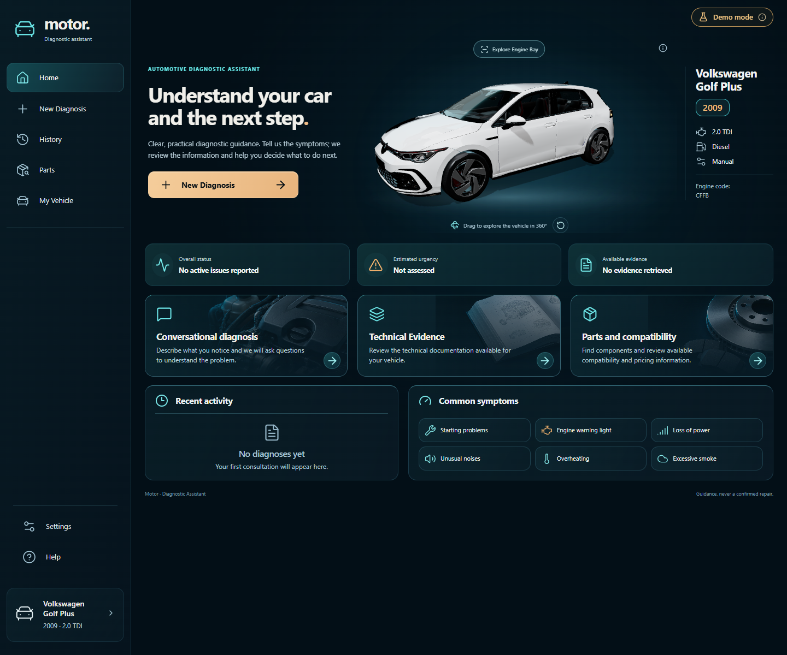
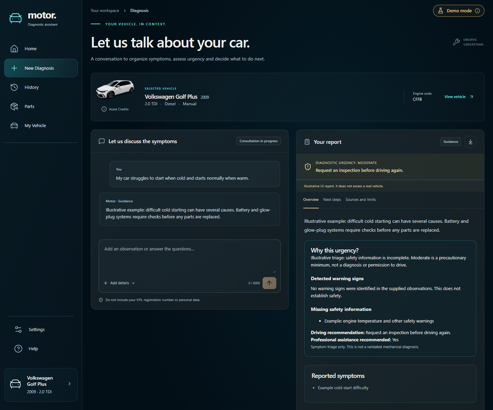
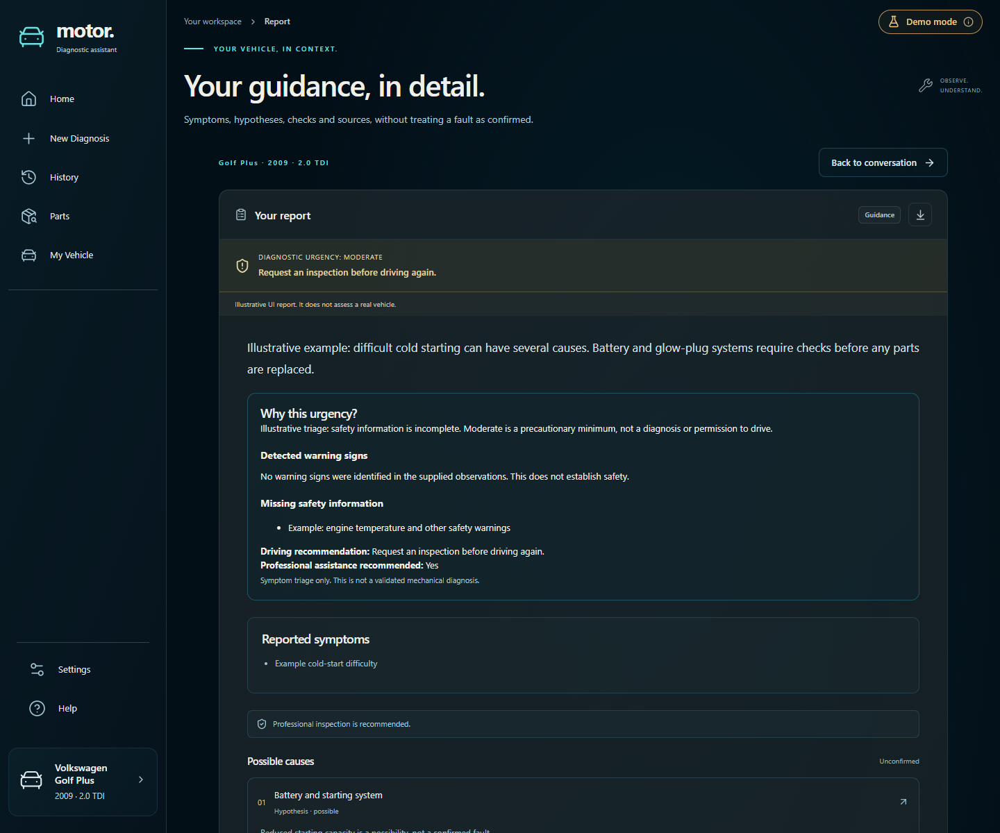
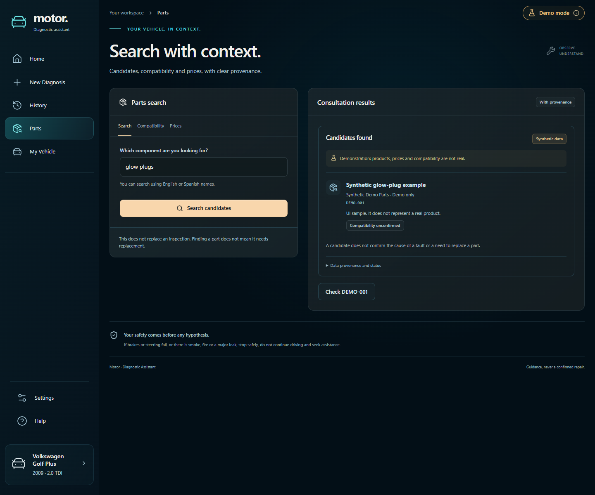
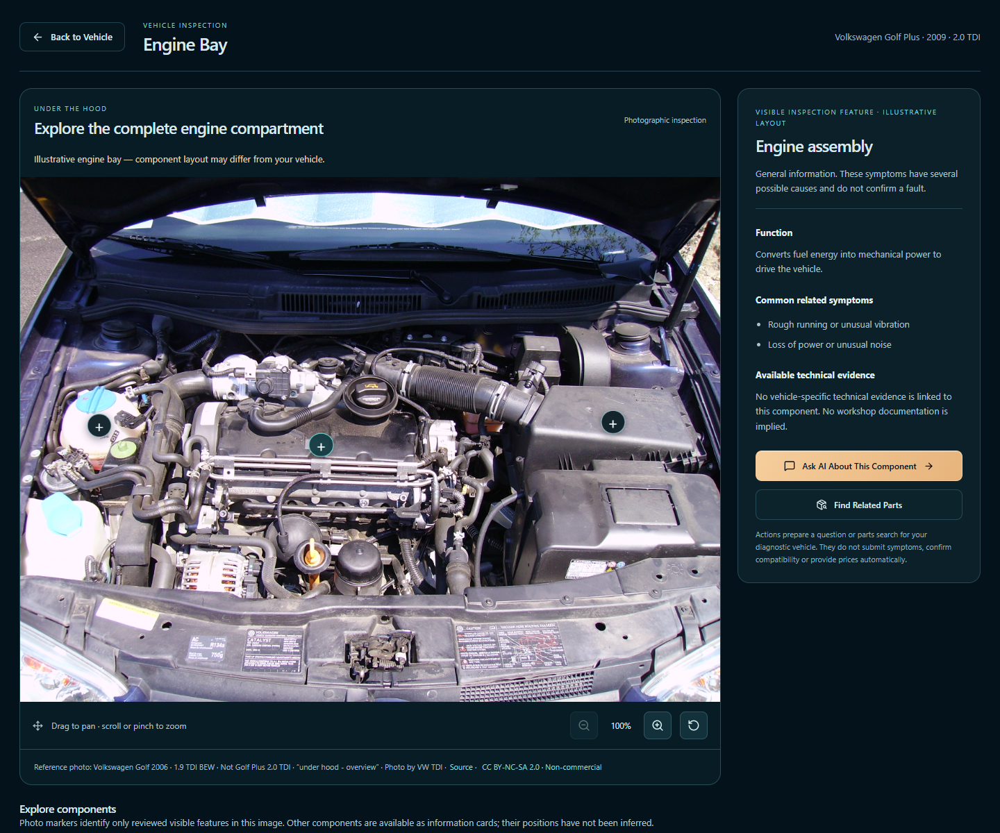
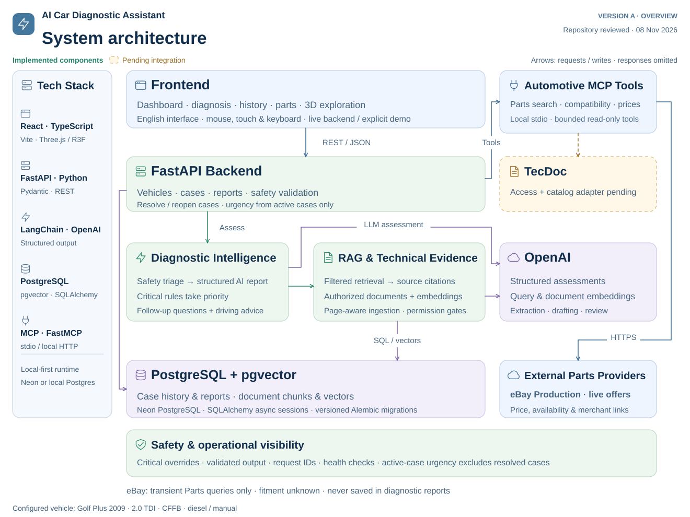

# Motor — AI Car Diagnostic Assistant

An automotive diagnostic assistant combining structured symptom assessment,
retrieved technical evidence and read-only parts tools.

## Product overview

Motor helps a non-mechanic turn observations into questions, possible causes and
professional verification steps. The MVP vehicle is a **Volkswagen Golf Plus 2009,
2.0 TDI, owner-reported CFFB, diesel, manual**. Other vehicle configurations are
currently rejected by the service policy.

Describe symptoms → assess safety → retrieve applicable evidence → review a
structured report → track the case → optionally explore parts. Reports retain
their original urgency and citations. Hypotheses are **not confirmed mechanical
faults**, and user-reported resolution is not independent proof of a repair.

## Product screenshots

These are real captures of the application in its explicit **browser-only demo**.
Reports and parts records are synthetic, not live OpenAI or merchant results.
The local 3D model and licensed Engine Bay photograph are actually rendered.



| Diagnosis workspace | Structured report |
| --- | --- |
| [](docs/screenshots/02-diagnosis.png) | [](docs/screenshots/03-report.png) |

| Parts Explorer | Vehicle and Engine Bay |
| --- | --- |
| [](docs/screenshots/05-parts.png) | [](docs/screenshots/07-engine-bay.png) |

[History](docs/screenshots/04-history.png) · [360° vehicle viewer](docs/screenshots/06-vehicle.png) ·
[Capture provenance](docs/screenshots/README.md)

## Key features

- Conversational symptoms, follow-up questions and structured diagnostic hypotheses.
- Deterministic safety overrides and hybrid Low / Moderate / High / Critical urgency.
  Missing information remains explicit; no active cases means **Not assessed**.
- PostgreSQL/pgvector retrieval with source eligibility, vehicle filters, lexical
  reranking and citations constrained to retrieved chunk IDs.
- Persistent conversations, reports, source citations and Active/Resolved case tracking.
- One automotive MCP server with three tools: search, compatibility and prices.
  Production/Sandbox eBay adapters and authored demo/unavailable providers exist.
- Interactive 360° Golf VIII visual, photographic Engine Bay zoom/pan and reviewed
  markers for the reference photo; component actions prepare editable questions/searches.

eBay search does not establish fitment. Offers are transient Parts queries and do
not enter saved reports or AI assessment context. TecDoc access and its adapter
remain pending. [Provider details](docs/technical/MCP.md).

## Architecture



[Detailed technical architecture](docs/architecture/technical-architecture.svg) ·
[Communication flows](docs/architecture/README.md)

React calls FastAPI over REST. Diagnostic services apply safety rules, request
structured OpenAI assessments and retrieve filtered evidence from PostgreSQL +
pgvector. A separate Parts pathway invokes the local MCP gateway/server and a
selected provider. SQLAlchemy transactions persist case data and original reports.

## Tech stack

| Area | Technologies |
| --- | --- |
| Frontend | React, TypeScript, Vite, Lucide |
| Visual inspection | Three.js, React Three Fiber, Drei, local GLB/photo assets |
| API | Python, FastAPI, Uvicorn, Pydantic |
| AI / RAG | LangChain, OpenAI structured output and embeddings, PyMuPDF |
| Persistence | PostgreSQL, pgvector, async SQLAlchemy/psycopg, Alembic |
| Tools | MCP Python SDK, LangChain MCP adapters, eBay OAuth/Browse |
| Verification | pytest, Ruff, Vitest, Testing Library, Playwright, GitHub Actions |

## Quick start

Requires Python 3.12, [uv](https://docs.astral.sh/uv/), Node.js 24 LTS and npm.
Full backend execution also needs PostgreSQL with pgvector; Compose is optional
when using an existing managed database. No credentials or private manuals ship.

**Explore the UI without a database or API keys:**

```bash
cd frontend
npm ci
npm run dev -- --port 5174
```

Open **http://127.0.0.1:5174/?demo=1**. Demo mode is intentionally synthetic and
is never an automatic fallback for a failed backend.

**Start the persistent backend** in a second terminal:

```bash
cd backend
uv sync --locked --extra dev --python 3.12
cp .env.example .env
# Edit .env: replace the local password and match DATABASE_URL.
docker compose up -d --wait
uv run --locked alembic upgrade head
uv run --locked python -m app.database.verify
uv run --locked python -m app
```

In PowerShell, replace `cp` with `Copy-Item`. Open **http://127.0.0.1:5174/** for
the backend-connected UI; API docs are **http://127.0.0.1:8002/docs**. The vehicle
seed is idempotent and created at backend initialization.

Set `OPENAI_API_KEY` in **backend/.env** for ordinary AI reports/embeddings.
Recognized deterministic critical hazards do not require the model. Enable the
authored MCP demo with `MCP_ENABLED=true` and `AUTOMOTIVE_PROVIDER=demo`, or add
your own eBay credentials for live read-only offers.

[Complete setup, managed PostgreSQL and troubleshooting](docs/setup/LOCAL_SETUP.md) ·
[Configuration examples](backend/.env.example)

## Example workflow

The screenshots use the real demo adapter: enter “My car struggles to start when
cold and starts normally when warm”, submit, inspect the Moderate synthetic report,
then resolve the case with the confirmation dialog. Parts searches show explicitly
synthetic examples. This exercises UI behavior; it is not a real vehicle diagnosis
or evidence of live RAG quality.

Separately, the development system has a documented bounded real-service check
using OpenAI, PostgreSQL and indexed references. The publication copy contains no
personal cases, private corpus, embeddings or merchant snapshots. See
[evaluation scope and historical evidence](docs/evaluation/README.md).

## Testing and evaluation

```bash
cd backend
uv run --locked pytest tests -m "not live and not database" -q
uv run --locked ruff check .
uv run --locked ruff format --check .
```

```bash
cd frontend
npm test
npm run build
npm run format:check
npx playwright install chromium
npm run test:e2e
```

Database tests require a separate `TEST_DATABASE_URL` with a database named
`test_...`; they refuse the development database. Normal CI uses no paid OpenAI
requests or commercial credentials. [Executed release checks and methodology](docs/evaluation/README.md).

Release status: backend/database and frontend unit/build checks pass. One browser
report-download check remains unresolved; this is **not an all-green release**.
[Publication review and remaining blockers](docs/RELEASE_READINESS.md).

## Limitations and roadmap

- A triage report is not mechanical validation or permission to drive.
- Incomplete safety information conservatively raises urgency and can require
  inspection before driving; detailed explanations appear in each report.
- Only seven internally authored generic demo documents are redistributed. Supply
  your own authorized references and explicitly index them for meaningful RAG.
- Source/ID validation does not establish that every generated claim is supported.
  Text-extracted wiring labels do not preserve circuit connectivity.
- Year/engine metadata is insufficient to establish gearbox/brake part fitment.
  The installed equipment is not independently verified by this application.
- eBay supplies merchant listings, not a verified parts catalog. TecDoc requires
  authorized access and adapter implementation. Provider availability is external.
- The approved Golf VIII exterior and Golf 1.9 TDI BEW Engine Bay are illustrative,
  not exact Golf Plus/CFFB geometry. The photograph is **non-commercially licensed**.
- This is a local MVP: general account authentication, public deployment controls
  and operational monitoring are future work, not implemented services.

## License and acknowledgments

Application code and original documentation: [MIT](LICENSE). Third-party resources
retain their own terms: the Golf GLB/poster is CC BY 4.0; the Engine Bay photo and
its annotations are CC BY-NC-SA 2.0. The complete bundle is **not uniformly MIT**
and the photo must be replaced or separately licensed for commercial use.

The PDF backend also depends on PyMuPDF (AGPL v3 / commercial dual license).
MIT for original files does not remove its obligations for the combined backend;
[dependency licensing review](docs/licenses/DEPENDENCY_NOTICES.md) is required
before representing the complete application as MIT-only.

[Asset credits and redistribution scope](docs/ASSET_CREDITS.md) ·
[Security policy](SECURITY.md) · [Contributing](CONTRIBUTING.md)

No affiliation with or endorsement by Volkswagen, eBay or the asset authors is implied.
