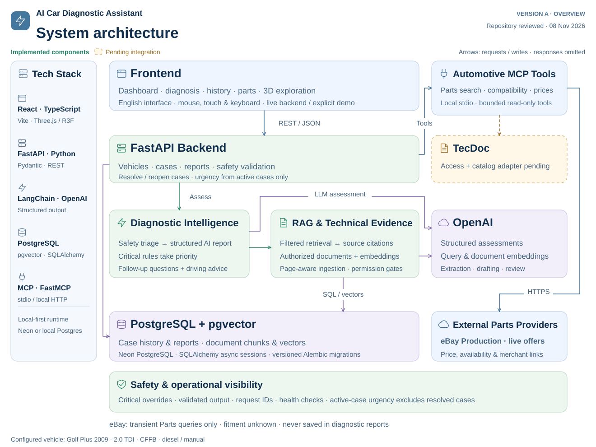

# Architecture

These diagrams reuse the repository-verified BARIA-inspired layouts, reviewed
8 November 2026. No alternative architecture has been introduced.

[Overview PNG](system-architecture.png) · [Technical SVG](technical-architecture.svg) ·
[Technical PNG](technical-architecture.png)

Frontend requests reach FastAPI. Diagnostic intelligence applies history-aware
safety triage, calls structured OpenAI extraction/draft/review when needed, and
requests applicable evidence from RAG. PostgreSQL stores both persistent cases and
pgvector embeddings. Administrator API/CLI operations ingest and index authorized
documentation; no corpus or vector store is bundled beyond authored demo notes.

The separate Parts API calls the automotive MCP gateway/server. eBay Production
and Sandbox adapters are implemented; credentials are supplied by each installer.
Offers remain transient and do not enter reports/model context. Demo/unavailable
providers exist. TecDoc remains pending, not an implemented catalog connection.

Solid components are implemented; dashed amber denotes pending work. Arrows show
requests/writes; responses are omitted for readability. No LangGraph, separate
vector service, voice stack, general login or production deployment is implied.

The overview is intended for README size; the technical version preserves model
IDs, table names, safety, transport and runtime specifics. Main source evidence:

- [Composition root](../../backend/app/main.py), [services](../../backend/app/services/), [routes](../../backend/app/api/routes/).
- [AI](../../backend/app/ai/), [RAG](../../backend/app/rag/), [database models](../../backend/app/database/models.py).
- [MCP gateway](../../backend/app/integrations/mcp/client.py), [server](../../backend/app/mcp/server.py), [provider factory](../../backend/app/mcp/providers.py).
- [Frontend](../../frontend/src/App.tsx), [visual assets](../../frontend/src/components/vehicle3d/), [credits](../ASSET_CREDITS.md).

Source architecture defaults describe the configured development workflow. This
release intentionally ships no credentials: local Postgres/pgvector and demo
providers are reproducible alternatives to the developer's managed services.
The diagrams were rendered and inspected at native and 960px README sizes, with
no intersecting connectors or clipped/overlapping labels in that layout review.
